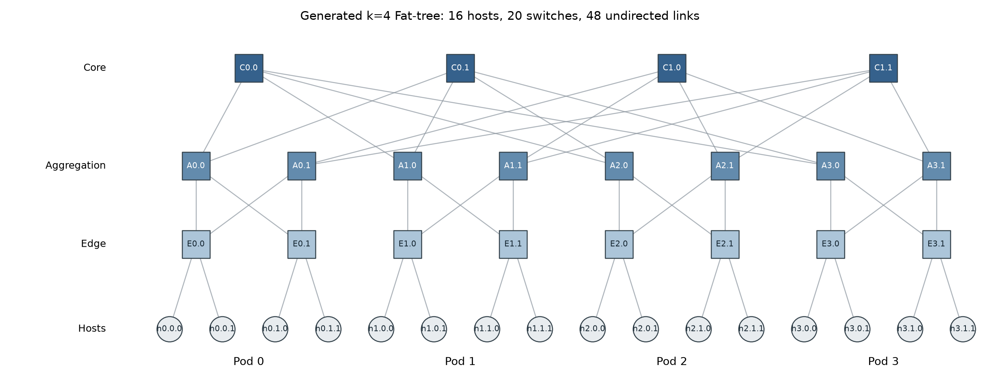
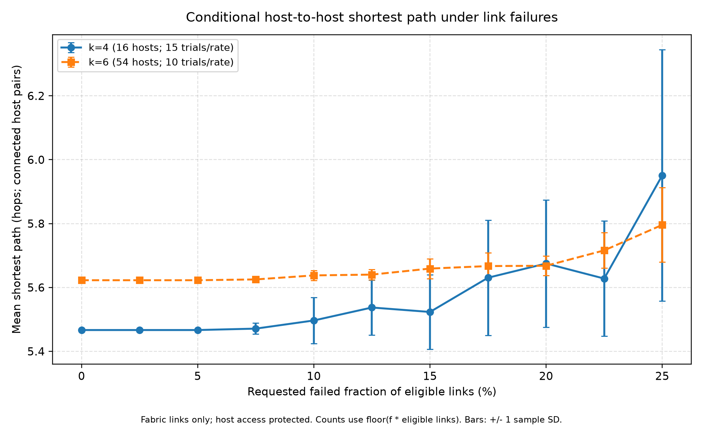
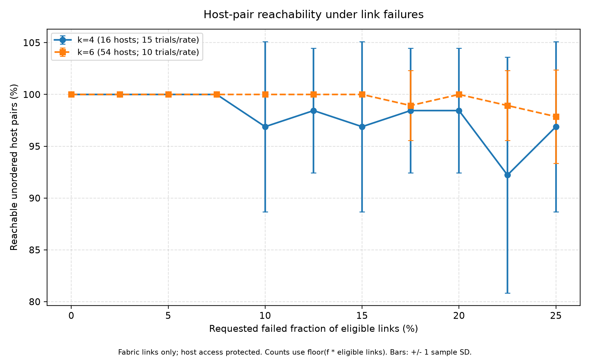

# Fat-Tree Network Topology Generation and Resilience Analysis

**Author:** Dor Sela  
**Course:** Data Center Networks & AI (361.2.2460)  
**Assignment:** Homework 1, version 2 (2026)

## 1. Objective and scope

How do random failures within a Fat-tree switch fabric affect host-to-host
reachability and shortest paths, and how does this differ between two network sizes?

The project generates the three switch tiers of the k-ary Fat-tree described by
Al-Fares, Loukissas and Vahdat [1]. Its **default failure model removes only
switch-to-switch links**, leaving host access links intact. This isolates fabric
resilience and follows the focus of the paper's Section 3.8: edge-aggregation and
aggregation-core failures that alternate fabric routes may bypass.

This is an experimental modelling choice. The assignment does not explicitly
specify whether host access links must be eligible for failure. An optional
`--include-host-links` flag supports the broader all-link model as well.

The implementation uses an undirected, unweighted NetworkX graph. A link is a
bidirectional connection; failure removes both directions. The analysis measures
available paths after failures, assuming surviving routes can be used. It does
not implement the paper's BFD/failure-broadcast protocol or simulate packets,
traffic loads, TCP, queues, routing convergence, throughput or latency. Architectural
bandwidth properties in the paper are motivation rather than measured results.

## 2. Topology and an illustrative example

The input `k` is an even integer at least 2: every switch's port count. Let `h=k/2`.

- There are `k` pods, each containing `h` edge and `h` aggregation switches.
- Each edge switch connects to `h` hosts and every aggregation switch in its pod.
- There are `h^2` core switches in `h` groups. Each core in group `j` connects to
  aggregation switch `j` in every pod.
- Hosts: `H=k^3/4`; switches: `S=5k^2/4`.
- All physical links: `M=3k^3/4`, equally split among host-edge,
  edge-aggregation and aggregation-core links.
- Default eligible fabric links: `L=k^3/2`. With host links included, `L=M`.
- Each host has degree 1; every switch has degree `k` before failures.



**Diagram setup:** `k=4`, no failures. The actual graph has 4 pods, 16 hosts,
8 edge switches, 8 aggregation switches, 4 core switches and 48 physical links.
Of those links, 32 are eligible for failure by default and 16 are protected host
access links. All links are drawn, including protected links.

Labels abbreviate the code's IDs: `Cj.i` identifies a core group/member, `Ap.a`
an aggregation switch, `Ep.e` an edge switch and `hp.e.h` a host. The core's
first index denotes its group, not a pod. Hosts are endpoints outside the three
switch tiers.

For `k=6`, there are 54 hosts, 45 switches, 162 physical links and 108 default
eligible links. The generator supports other valid even `k`; the supplied
experiment comparison uses `k=4,6`.

## 3. Installation and execution

Verification used Python 3.12.14, NetworkX 3.7, Matplotlib 3.11.2 and NumPy 2.5.4.
Use Python 3.12 or newer and the pinned dependency snapshot for reproduction.

```bash
git clone https://github.com/dor-sela/fat-tree-topology.git
cd fat-tree-topology
python -m venv .venv
```

Activate on Windows PowerShell:

```powershell
.\.venv\Scripts\Activate.ps1
```

Or on Linux/macOS:

```bash
source .venv/bin/activate
```

Install and run the default fabric-only analysis:

```bash
python -m pip install -r requirements-lock.txt
python main.py --k 4
python main.py --k 6 --failure-rate 0.10 --seed 42
python run_experiments.py
python -m unittest discover -s tests -v
```

`requirements.txt` retains the original minimum-version constraints as an
alternative. Different Python/library versions may change random samples or
rendering; the recorded versions define the verified environment.

### Inputs

- `main.py --k`: even integer >= 2; default `4`.
- `main.py --failure-rate`: finite fraction in `[0,1]`; default `0.0`. Use `0.10`
  for 10% of the **eligible pool**, not `10` and not 10% of all physical links.
- `main.py --seed`: integer, default unset; unseeded selection is nondeterministic.
- `--include-host-links`: available in both scripts; expands eligibility to all
  physical links. Default is false. `--no-include-host-links` explicitly selects
  fabric-only mode.
- `run_experiments.py --iterations`: positive integer overriding trial count for
  both sizes. Defaults remain 15 for `k=4` and 10 for `k=6`.
- `run_experiments.py --output-dir`: output folder; default is `results/` beside
  the script, independently of the working directory.

The `k=6`, requested 10% CLI example starts with 99 nodes, 162 physical links
and 108 eligible links. It removes 10 fabric links, leaving 152 physical links.
The realized eligible-pool fraction is `10/108=9.2593%`, and the fraction of all
physical links removed is `10/162=6.1728%`.

The CLI's whole-graph connectivity flag includes all switches. An isolated core
switch can make that flag false while all host pairs remain reachable. The
experiment metrics specifically measure host-pair communication.

Examples of optional runs that keep the checked-in default results intact:

```bash
python main.py --k 4 --failure-rate 0.10 --seed 42 --include-host-links
python run_experiments.py --include-host-links --output-dir results-all-links
python run_experiments.py --iterations 100 --output-dir results-100
```

The all-link option reproduces the earlier submission's default mean results
under the same parameters, seeds and verified environment. The current default
intentionally changes those results by changing the failure pool.

With more than 25 trials per rate, the preserved seed schedule can reuse seed
values across different settings. Seeds within each setting are distinct, but
points should not be assumed independent for formal statistical comparisons.

## 4. Failure model and rounding

Let `M` be all physical links and `L` the eligible links:

```text
Default:                 L = k^3/2     (edge-aggregation and aggregation-core)
With --include-host-links: L = 3k^3/4   (all physical links)

m = floor(L * requested_failure_fraction)
actual_failed_fraction = m / L
fraction_of_all_links_removed = m / M
```

Exactly `m` links are sampled uniformly without replacement. This is fixed-count
removal, not an independent Bernoulli failure probability. Nodes remain present;
each trial perturbs a fresh copy of the intact graph. The input graph and caller's
global random state are preserved. If the eligible pool is empty, no links fail.

Rounding is significant for small graphs. At requested 10%, `k=4` removes
`3/32` eligible links (9.375%), while `k=6` removes `10/108` (9.2593%). At
requested 25%, both remove exactly 25% of their eligible pools: 8 and 27 links.
These removals equal only 16.6667% of all physical links in either graph.

For `k=4`, requested 2.5% removes zero links, and requested 12.5% and 15% both
remove four. Their samples use different seeds, so finite-sample means may differ
even though the realized failure count is identical.

The plots use the explicitly labelled **requested percentage of eligible links**
to keep the 11 experiment settings distinct. Both actual denominators and counts
are recorded in the CSV files. This replaces the preceding all-link review's
actual-percentage plotting axis, which would repeat x coordinates in this grid.

## 5. Metrics and experiment design

Let `P` contain all unordered pairs of distinct original hosts, and `C` the
pairs still connected in a trial. Each pair is counted once:

```text
reachability = |C| / |P|
conditional mean path = sum(distance(u,v) for (u,v) in C) / |C|
```

Path length is in links/hops, including host access links. Disconnected hosts
stay in the reachability denominator. Unreachable pairs are excluded from the
conditional path mean; if no pair is connected, that mean is NaN internally and
blank in CSV. For fewer than two hosts, reachability is 1 by convention and path
mean is undefined. These definitions also apply in optional all-link mode.

The checked-in experiment uses:

- Fabric-only failures; host access links protected.
- `k=4`: 16 hosts, 20 switches, 48 physical/32 eligible links; 15 trials per rate;
  base seed 100.
- `k=6`: 54 hosts, 45 switches, 162 physical/108 eligible links; 10 trials per rate;
  base seed 200.
- Requested fractions `0,0.025,0.05,...,0.25`: 11 settings per size.
- Zero-based seed: `base_seed + int(f * 1000) + iteration`.
- 275 observations and 22 setting summaries.

Points are equal-weight means of per-trial means, rather than pooling all
connected pairs across trials. Undefined path means are omitted, with their
number exposed by `valid_path_trials`. Error bars show +/- one sample standard
deviation (`ddof=1`) when at least two valid observations exist. They are
descriptive variability bars, not confidence intervals. Symmetric SD bars can
extend above 100% even though individual reachability observations cannot.

### Analytical checks

In an intact graph, a host has `h-1` destinations at distance 2, `h(h-1)` at
distance 4 and `h^2(k-1)` at distance 6, for `h=k/2`. Therefore:

```text
L0 = [2(h-1) + 4h(h-1) + 6h^2(k-1)] / (H-1)
```

The predicted means are 5.466667 hops for `k=4` and 5.622642 for `k=6`, both
with 100% reachability. Tests match these values. Enumerating every single fabric
link failure for `k=4` preserves both the intact path mean and full reachability.

At 100% fabric failure, host access links remain. Pairs on the same edge switch
can still communicate at distance 2. Reachability is `(h-1)/(H-1)`: `1/15` for
`k=4`, `2/53` for `k=6`, and zero for `k=2` because each edge has only one host.
At 100% failure in optional all-link mode, no pair is connected and path mean
is undefined. The two scopes intentionally have different endpoint behavior.

## 6. Results and interpretation

### Experiment A: conditional shortest path versus fabric failures



**Setup:** fabric-only failure pool, sizes and settings in Section 5. Host access
links stay intact. Each point is an average over a new set of failed graphs.

**Observed examples:** at requested 10%, the means are 5.496618 hops for `k=4`
and 5.637736 for `k=6`. At requested 25%, they are **5.950918** and **5.795890**
hops, respectively. Endpoint sample SDs are 0.393820 and 0.116655 hops.

**Explanation:** missing fabric links remove shortest routes and can force
detours while hosts remain connected. A higher initial mean for `k=6` follows
from a larger share of inter-pod pairs, rather than a failure. An individual
surviving pair's distance cannot decrease under nested deletions, but this plot
uses different sampled failure sets and changing connected-pair populations.
For example, the `k=4` mean falls from 5.674976 at requested 20% to 5.627826 at
22.5% while reachability falls too. This does not imply improved health.

**Significance:** read path mean together with connectivity. A small mean
increase does not measure retained path diversity or bandwidth. Sample counts
are modest and SD bars overlap; no significance test or universal size ranking
is claimed.

### Experiment B: host-pair reachability versus fabric failures



**Setup:** the same graphs as Experiment A; all original host pairs stay in the
denominator. Any disconnection in this default experiment comes from fabric
partitioning rather than removal of host access links.

**Observed examples:** at requested 10%, mean reachability is **96.8889% for
`k=4`** and **100% for `k=6`**. At requested 25%, it is **96.8889%** and
**97.8616%**, with endpoint sample SDs of 8.2102 and 4.5081 percentage points.
The 100% result is an observation of the recorded trials, not a guarantee that
all failure sets at that rate preserve connectivity.

**Explanation:** multiple fabric routes can retain connectivity after individual
links fail. If an edge switch loses all its uplinks, its attached hosts can
still reach one another but cannot reach other edge-switch groups. Larger `k`
offers more inter-pod shortest routes, but these small samples alone cannot
establish a universal resilience advantage.

**Finite-sample limitations:** the `k=4` mean rises from 92.2222% at requested
22.5% to 96.8889% at 25%. Different failure sets are sampled at every point,
so this is sampling variability, not evidence that deleting more links improves
connectivity. Rounding can also make distinct requests produce the same failure
count. More trials and aligned realized counts would support stronger comparisons.

**Scope comparison:** the earlier all-link submission had 47.8889% and 56.0867%
reachability at requested 25%. Those values refer to a different eligible pool,
including host access links; they are not current default results. They remain
reproducible with `--include-host-links`. In the default, host attachment
survival is guaranteed by the model rather than measured as an additional risk.

## 7. Outputs and repository structure

```text
.
|-- main.py                     # Topology/failure CLI and scope flag
|-- run_experiments.py          # Figures, observations and run metadata
|-- requirements.txt            # Original minimum dependency constraints
|-- requirements-lock.txt       # Verification dependency versions
|-- README.md
|-- src/
|   |-- __init__.py
|   |-- fat_tree.py             # Three switch tiers and hosts
|   |-- failure_model.py        # Eligible pool and fixed-count removal
|   `-- metrics.py              # Host-pair metrics and repeated trials
|-- tests/
|   `-- test_network.py         # 15 regression tests, including both scopes
`-- results/
    |-- topology_k4.png
    |-- path_length_vs_failure.png
    |-- reachability_vs_failure.png
    |-- trials.csv              # 275 fabric-only trial records
    |-- summary.csv             # 22 fabric-only summaries and sample SDs
    `-- experiment.json         # Scope, denominators, parameters and versions
```

Trial and summary records identify `failure_scope`, `include_host_links`,
`eligible_links`, `total_links`, requested/actual fractions and removed counts.
`actual_failed_fraction` is normalized by eligible links;
`fraction_of_all_links_removed` is normalized by all physical links. Trial
records also contain seeds and pair counters. Reachability and its SD are stored
as fractions; multiply by 100 for percent and percentage points, respectively.

The figures and discussion describe the checked-in default run. Alternate runs
regenerate outputs but do not automatically rewrite this discussion. Virtual
environments, bytecode, Git internals and review artifacts are not submission files.

Graph generation uses `O(k^3)` nodes and links. Exact host-pair analysis runs
BFS from each host: `O(H*(V+E))`, or `O(k^6)` here. Distances are accumulated
rather than stored for all pairs. Large `k` is supported but expensive to analyze.

## 8. Verification and class discussion

Fifteen tests check graph invariants, core wiring, analytical baselines, failure
counts in both scopes, protected host links, an empty eligible pool, reproducibility,
input-graph/global-RNG preservation, independent BFS, isolated-host denominators,
undefined metrics, exact single-link enumeration, both full-failure limits, CLI
scope selection and exported denominators. Optional all-link mode was also
checked against the 44 mean values from the preceding reviewed submission.

Be prepared to explain:

1. Why the topology counts and switch degrees follow the formulas in Section 2.
2. Why 10% requested removal differs from actual removal and from total-link loss.
3. How protecting host access isolates the study of fabric resilience.
4. Why 100% fabric failure can retain same-edge host pairs.
5. Why conditional path means and sampled reachability need not be monotonic.
6. Why these metrics do not establish throughput or routing convergence.

## 9. Coverage of the assigned paper

The homework's Section 2 asks for a Fat-tree topology consistent with [1] and
three switch tiers. Sections 4-6 separately ask for link failures, a meaningful
metric, plots and discussion. They do not explicitly request reproducing every
protocol or throughput experiment in the paper. This project addresses that
structural-analysis scope.

- **Paper Section 2.2:** implemented. Pods, hosts, the three switch tiers and
  core-group wiring follow the construction. Link counts refer to undirected
  physical connections; unweighted edges define hop cost, not a bandwidth model.
- **Section 3.2:** the paper's IPv4 addressing is not implemented. Descriptive
  node IDs and layer/pod attributes identify vertices for topology analysis.
- **Sections 3.3-3.5:** two-level prefix/suffix tables, port-based forwarding and
  TCAM lookup are not implemented. BFS computes graph distances using knowledge
  of the whole surviving graph; it is not the paper's forwarding algorithm.
- **Sections 3.6-3.7:** the alternative flow-classification and central-scheduling
  schemes are not implemented. There are no flow sizes, reservations or balancing.
- **Section 3.8:** default eligible failure classes match the fabric links in
  that discussion. BFD sessions, failure tags/broadcasts, convergence, repair
  events and switch-failure injection are not implemented.
- **Sections 3.9 and 6:** power, heat and physical rack/cable packaging are not
  modeled. The topology drawing represents logical connectivity.
- **Sections 4-5:** Click/NetFPGA prototypes and the bandwidth benchmarks are not
  reproduced. Table 2's percentages measure achieved aggregate bandwidth;
  this project's reachability percentages measure connected host pairs.

### Example: a graph detour does not establish paper-protocol recovery

After multiple failures, a graph shortest path may descend to an intermediate
edge switch and then climb to another aggregation switch. The ordinary intact
architecture uses 2/4/6-hop paths. Its described forwarding and failure mechanisms
do not establish support for every longer detour that unrestricted BFS can find.

For `k=4`, fraction `0.075`, seed `184`, two fabric links fail:
`edge_p2_e0--agg_p2_a1` and `edge_p0_e0--agg_p0_a0`. No ordinary six-hop route
remains between `host_p0_e0_h0` and `host_p2_e0_h0`, but a graph route exists:

```text
host_p0_e0_h0 -> edge_p0_e0 -> agg_p0_a1 -> core_j1_i0
 -> agg_p2_a1 -> edge_p2_e1 -> agg_p2_a0 -> edge_p2_e0
 -> host_p2_e0_h0
```

The eight-hop route passes through an intermediate edge switch. Reproduce the
graph path in the verified environment:

```python
import networkx as nx
from src.fat_tree import FatTreeTopology
from src.failure_model import FailureModel
graph, _ = FailureModel.inject_link_failures(FatTreeTopology(4).graph, 0.075, 184)
path = nx.shortest_path(graph, "host_p0_e0_h0", "host_p2_e0_h0")
print(path)
print(len(path) - 1)  # 8 hops
```

The published metrics count this as a reachable pair with an eight-hop shortest
path. That is correct for the chosen structural metric. It does not demonstrate
packet delivery by the paper's routing protocol. Graph reachability is an upper
bound on delivery possible under a specified forwarding policy; graph distance
is a lower bound on that policy's route length in hops. Neither quantity is a
measurement of throughput, latency or convergence.

author remains responsible for understanding and checking everything submitted.
Codex also assisted with a full-paper coverage audit and the clarification in
Section 9 distinguishing graph routes from the paper's forwarding mechanisms.
